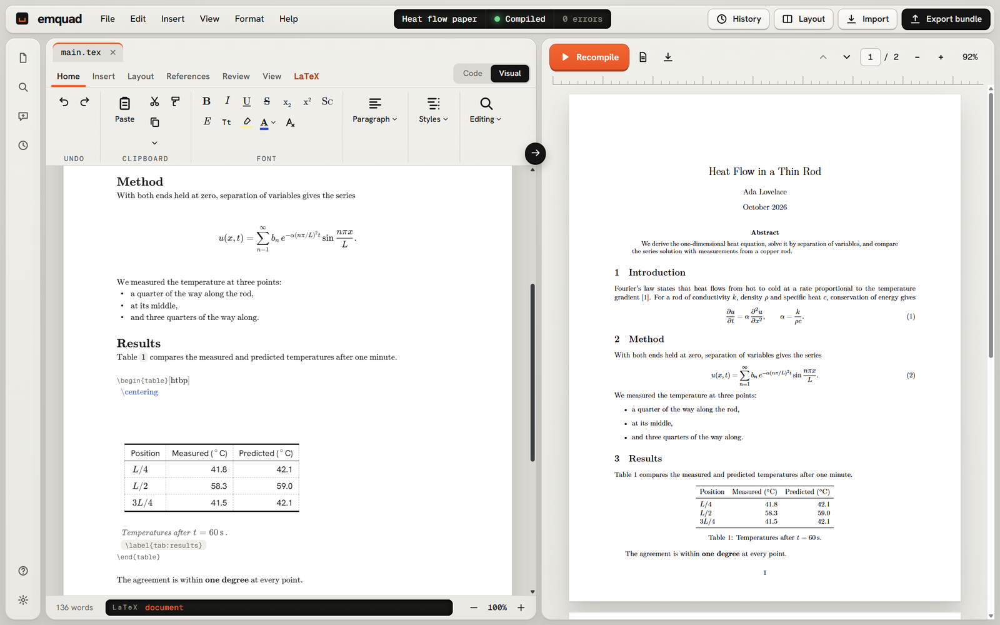
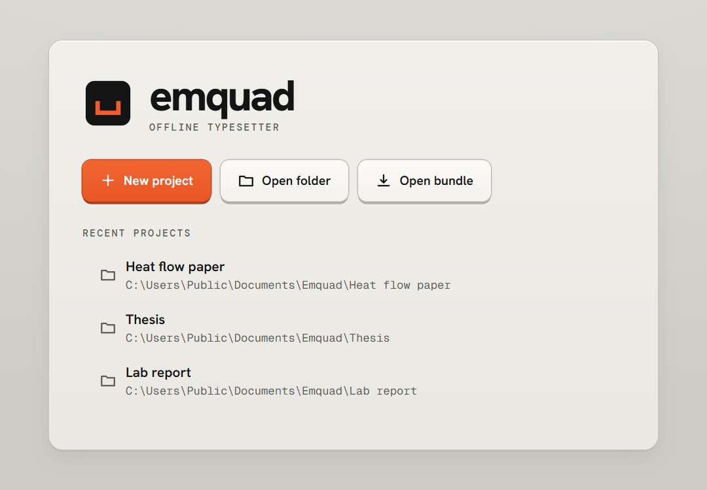
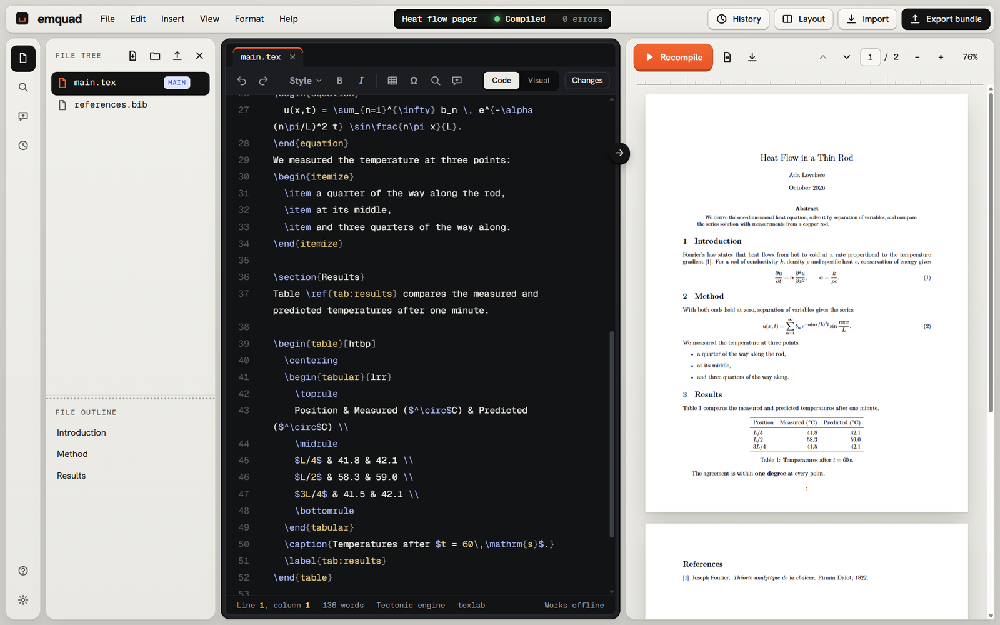
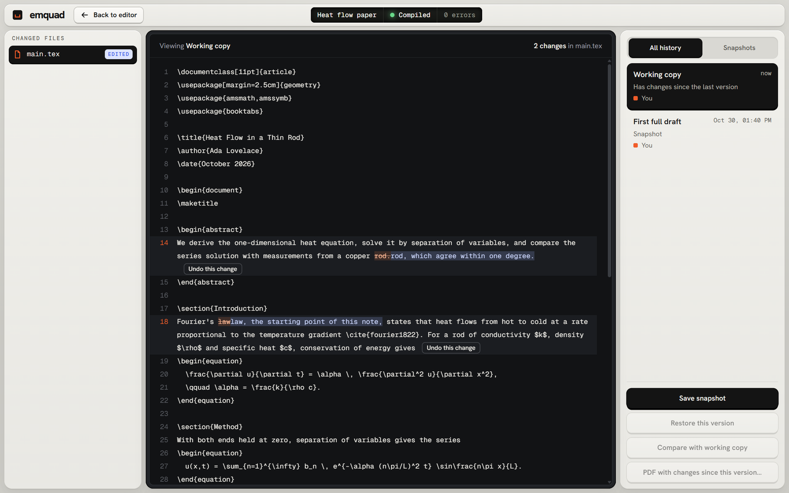
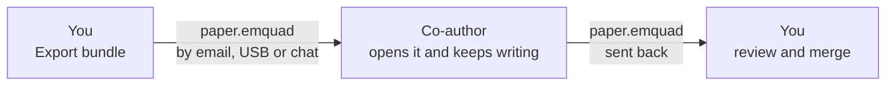
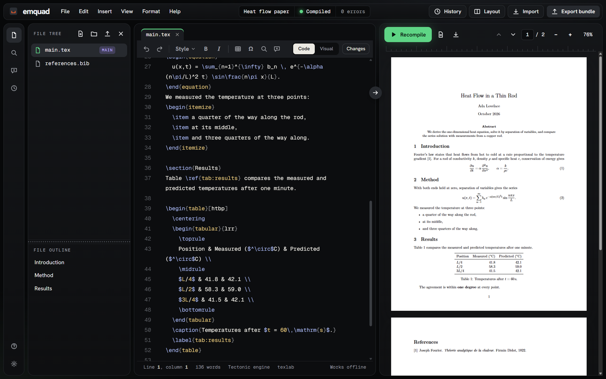

<div align="center">


# Emquad

**A free, offline LaTeX editor for Windows.**<br>
Write on a page like in Word, or in LaTeX source like in Overleaf, and see the typeset PDF beside it.<br>
No account, no TeX Live or MiKTeX to install, and no internet needed once your packages are downloaded.

[](https://github.com/TamerAbdelmigid/Emquad/releases/latest)

[](https://github.com/TamerAbdelmigid/Emquad/releases/latest)
[](https://github.com/TamerAbdelmigid/Emquad/releases)
[](LICENSE)
[](#download-and-install)



</div>

## Why Emquad?

Most LaTeX editors make you choose: **Overleaf** is easy but needs an account and an internet connection, and **desktop editors** such as TeXstudio or TeXmaker need a TeX distribution installed and set up first. Emquad is a desktop LaTeX editor that needs neither.

- 📴 **Works offline.** Everything happens on your computer; the internet is used only to download a LaTeX package the first time a document needs it. Your papers never leave your computer unless you send them.
- 📦 **Nothing else to install.** The LaTeX compiler (Tectonic) comes inside the installer. Install, open, write.
- 📝 **Word-like editing, real LaTeX underneath.** The page view has a ribbon with Word's Home, Insert, Layout, References and Review tabs. Every button writes plain LaTeX you can read and change.
- 👀 **Live PDF preview.** Press **Ctrl+Enter** and the PDF updates beside your text. Double-click the PDF to jump to the line that made it.
- 🕒 **History built in.** Snapshots, a full version history, and side-by-side comparisons, with no Git to learn.
- 🤝 **Collaborate by sending one file.** Export a `.emquad` bundle, send it by email or USB stick, and review and merge the changes that come back.
- 📂 **Your files stay plain.** A project is an ordinary folder of `.tex` and `.bib` files that any other LaTeX tool can open.

## Download and install

1. Go to the **[latest release](https://github.com/TamerAbdelmigid/Emquad/releases/latest)** and download `Emquad_x.y.z_x64-setup.exe` (about 30 MB).
2. Run it. It installs for your Windows user only, so it does not ask for administrator rights.
3. Windows may show **"Windows protected your PC"**, because the installer is not yet code-signed. Click **More info**, then **Run anyway**.
4. Start **Emquad** from the Start menu.

Emquad is built and tested on Windows 11 (64-bit), and should also run on Windows 10. It uses Microsoft Edge WebView2, which Windows 11 already has; on a computer without it, the installer downloads it.

## Your first document in two minutes

1. **Type your name** when Emquad first asks. It goes on your snapshots, so a co-author can tell whose changes are whose.
2. Choose **New project**, give it a name, and pick a starting point: **article**, **report**, **thesis**, **exam** or **letter**.
3. Emquad compiles it straight away and the PDF appears on the right.
4. **Write.** Use the ribbon as you would in Word, or switch to **Code** to type LaTeX.
5. Press **Recompile** (or **Ctrl+Enter**) to see your changes in the PDF.

> [!NOTE]
> The first time a document uses a LaTeX package, Emquad downloads it, so the first compile needs internet. After that the document compiles offline, unless you add a package it has not fetched before.

<p align="center"></p>

Already have LaTeX files, or an Overleaf project? Download the project from Overleaf as a zip (Menu → Download → Source), unzip it, and choose **Open folder** in Emquad.

## What you can do

### Write on a page, like in Word

The page view draws your document as it will print: headings, bold and italic, typeset mathematics, lists, tables, pictures, citations and cross-references. Underneath, it is still your LaTeX.

- **Home:** bold, italic, underline, colours, highlight, bullets and numbering, alignment, styles, and a format painter.
- **Insert:** tables, pictures (drag them in or paste them), equations, footnotes, links, cross-references, header and footer.
- **Layout:** margins, orientation, paper size, columns and line numbers.
- **References:** citations from your `.bib` file or from **Zotero**, citation styles (IEEE, APA, Harvard and more), and the bibliography.
- **Review:** word count, comments shown as balloons, and the changes since any snapshot.
- **An equation editor** where you type maths as in Word: `1/2` becomes a fraction, `alpha` becomes α.
- **Split with LaTeX** shows the source beside the page; edit either side.

### Or write LaTeX directly, with help



- Syntax highlighting, completion for commands, environments, labels and citation keys, and `\end{…}` added for you.
- Errors are marked on their line and **explained in plain words**, with a one-click fix where the fix is certain, such as adding a missing `\usepackage`.
- Go to definition, find references and rename labels (through the texlab language server).
- **Jump between source and PDF** in both directions.
- Spell checking in English, French, Spanish, Dutch and Russian.
- A symbol panel of Greek letters, operators, arrows and more, searchable by name.

### Keep every version



Save a snapshot whenever you like (**Ctrl+Shift+S**); Emquad also keeps versions while you write. **History** shows what changed in each version, word by word, and restores any of them. A restore saves your current work first, so it can always be undone.

### Collaborate without the cloud



A **bundle** is one `.emquad` file holding your sources, their history, and optionally the PDF, your comments and the LaTeX packages (so it compiles on a computer with no internet at all). Your co-author opens it in Emquad, writes, and sends a bundle back. You see every change they made, resolve any passage you both changed, and **Finish merge**. Nothing is overwritten without a snapshot first.

Working with someone who uses Word? **Send to Word** and **Open a Word file** convert through Pandoc, if you have it installed.

### Make it yours



Three themes (the light Fieldwork, Glass, and the dark Onyx), adjustable text size, and keyboard shortcuts for the common actions. Press **Alt** to see KeyTips on the ribbon, as in Word, and reach every tool from the keyboard.

## How Emquad compares

| | Emquad | Overleaf | TeXstudio, TeXmaker |
|---|:---:|:---:|:---:|
| Works without internet | ✅ ¹ | ❌ | ✅ |
| No account needed | ✅ | ❌ | ✅ |
| No TeX distribution to install | ✅ | ✅ | ❌ |
| Word-like visual editing | ✅ | Partly (Visual Editor) | ❌ |
| Version history with no setup | ✅ | ✅ ² | ❌ |
| Free and open source | ✅ | Free tier; open-source self-hosted edition | ✅ |

<sub>¹ After the LaTeX packages a document uses have been downloaded once. ² Full history on Overleaf's paid plans.</sub>

## Questions

<details>
<summary><b>Do I need to install MiKTeX or TeX Live?</b></summary>

No. Emquad ships its own compiler, Tectonic, which fetches only the LaTeX packages a document uses, the first time it needs them. If you already have a TeX installation and a document needs it (for example one that uses `minted`), you can switch that project to `latexmk` in Settings.
</details>

<details>
<summary><b>Does it really work offline?</b></summary>

Yes. Emquad uses the internet only to download a LaTeX package the first time a document needs it, and to fetch WebView2 during installation on a computer that lacks it. A project received in a bundle that carried its packages compiles with no internet at all.
</details>

<details>
<summary><b>Will Emquad change my .tex files?</b></summary>

Only with what you type or choose. It never writes markers or metadata into your files; its own data (history, comments) lives in a hidden `.emquad` folder inside the project.
</details>

<details>
<summary><b>Can I open my Overleaf projects?</b></summary>

Yes. In Overleaf, choose Menu → Download → Source to get a zip, unzip it, and choose **Open folder** in Emquad. To go back, zip the project folder (you can leave out the hidden `.emquad` folder) and use New Project → Upload Project in Overleaf.
</details>

<details>
<summary><b>Is there a Mac or Linux version?</b></summary>

Not yet. Emquad is built with Tauri, which runs on all three, and no design choice blocks a Mac or Linux version, but only Windows is built and tested today.
</details>

<details>
<summary><b>Is it free?</b></summary>

Yes, free and open source under the MIT licence, for personal, academic and commercial use.
</details>

## Learn more

- 📘 **[User guide](docs/user-guide.md):** every feature, step by step, and all keyboard shortcuts.
- 📝 **[Changelog](CHANGELOG.md):** what each version changed.
- 🐞 **[Report a problem or suggest a feature](https://github.com/TamerAbdelmigid/Emquad/issues)**

Current version: `0.20.1`.

## For developers

Emquad is built with [Tauri 2](https://tauri.app) (Rust) and React with [CodeMirror 6](https://codemirror.net). PDFs are drawn with [PDF.js](https://mozilla.github.io/pdf.js/), mathematics with [KaTeX](https://katex.org) and [MathLive](https://cortexjs.io/mathlive/), documents are compiled by [Tectonic](https://tectonic-typesetting.github.io), and language help comes from [texlab](https://github.com/latex-lsp/texlab).

### Run from source

Prerequisites on Windows: the Rust toolchain (MSVC), the Microsoft C++ build tools, Node.js and pnpm.

```bash
pnpm install
```

To compile documents the app needs a LaTeX engine. It uses the bundled Tectonic if present, otherwise a `latexmk` found on PATH. With texlab present it also gets hover, go to definition, references and rename. To fetch both into `src-tauri/sidecars/`:

```bash
pwsh scripts/fetch-sidecars.ps1
```

The script takes the latest releases; the app was last verified with Tectonic 0.17.0 and texlab 5.26.0. Then start the app:

```bash
pnpm tauri dev
```

### Build the installer

With Tectonic fetched into `src-tauri/sidecars/`:

```bash
pnpm tauri build
```

The installer is written to `src-tauri/target/release/bundle/nsis/`. It installs for the current user, includes Tectonic, and registers `.emquad` files so they open in Emquad. [docs/releasing.md](docs/releasing.md) covers the release checks and signing.

### Check it

```bash
pnpm verify
```

checks that the version is the same everywhere it is written (`scripts/check-version.mjs`), then runs `cargo fmt --check`, `cargo clippy`, the Rust tests, type-check, lint and the TypeScript unit tests. One Rust test compiles a real document and is skipped on a machine with no LaTeX engine.

`scripts/e2e.js` drives the real app window through compile, source/PDF lookup, export, import and a merge with a conflict. `scripts/keyboard.mjs` uses the app with real key presses only (sent over WebView2's debugging port, so nothing reaches other windows) and checks where the keyboard goes. `scripts/smoke-release.js` checks a release build: the packaged frontend, fonts, PDF viewer and bundled compiler. `scripts/installed-test.ps1` checks the installed copy. How to run each is at the top of the file.

### Read in this order

| File | What it answers |
|---|---|
| [docs/01-product-spec.md](docs/01-product-spec.md) | What the app does, for whom, and what is out of scope |
| [docs/02-architecture.md](docs/02-architecture.md) | The stack, the process model, modules, and the command surface between UI and backend |
| [docs/03-bundles-and-history.md](docs/03-bundles-and-history.md) | Snapshots, the `.emquad` file format, import, conflict detection, and merge |
| [docs/04-design-system.md](docs/04-design-system.md) | The Fieldwork visual design, layout rules, and component inventory |
| [docs/05-implementation-plan.md](docs/05-implementation-plan.md) | Milestones in build order, each with acceptance criteria and current state |
| [docs/06-open-items.md](docs/06-open-items.md) | What remains to do, decisions waiting for the owner, and review notes not yet dealt with |
| [AGENTS.md](AGENTS.md) | Working rules for anyone (human or agent) changing this repository, including how versions are numbered |

### Layout

| Path | What is there |
|---|---|
| `src-tauri/src/` | The Rust core: `project`, `compile`, `synctex`, `history`, `diff`, `bundle`, `review`, `index`, `settings`, and the thin `commands` layer |
| `src/` | The interface: `app/` (shell, actions, dialogs), `features/` (editor, preview, files, history, start), `design/` (tokens and styles), `ipc/` (typed command wrappers and generated types) |
| `mockup/` | The approved design, [mockup/emquad-fieldwork.html](mockup/emquad-fieldwork.html), the logo sheet [mockup/emquad-logo.html](mockup/emquad-logo.html), and earlier explorations kept for reference |
| `scripts/` | The end-to-end, keyboard and release checks, and the sidecar download script |

The name comes from the em quad, the square blank a typesetter sets between words (`\quad` in LaTeX).

## Licence

Emquad is free software under the [MIT licence](LICENSE), © 2026 Tamer A. Abdelmigid. The programs and libraries it ships with keep their own licences, listed in [THIRD-PARTY-NOTICES.md](THIRD-PARTY-NOTICES.md). texlab, which is GPL-3.0, is a separate program the app starts, not part of it.

<sub>Keywords: LaTeX editor, offline LaTeX editor, LaTeX editor for Windows, Overleaf alternative, desktop Overleaf, WYSIWYG LaTeX editor, visual LaTeX editor, LaTeX IDE, TeX editor, thesis writing, scientific writing, Tectonic.</sub>
